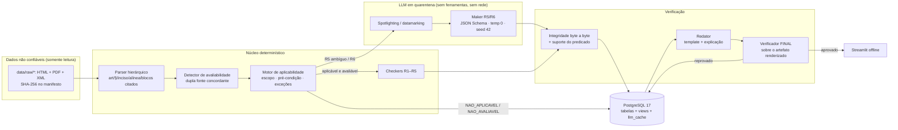

# Auditor 12.002

> **Portal de documentação:** [verifylex-org.github.io/auditor-12002](https://verifylex-org.github.io/auditor-12002/) — domínio, arquitetura, protocolo experimental e quickstart.
>
> **Estado atual:** especificação, governança e CI estão prontos. Os módulos de execução (`parser/`, `rules/`, `llm/`, `verify/`, `pipeline/`, `eval/`, `sql/`, `app/`) existem como stubs e estão no roadmap.

> **Aviso de independência:** Este é um projeto independente de código aberto, desenvolvido exclusivamente sobre dados públicos oficiais (Diário Oficial da União, Câmara dos Deputados e Portal da Legislação). Não possui vínculo institucional, patrocínio ou endosso da Casa Civil, da Secretaria Especial para Assuntos Jurídicos (SAJ) ou da Universidade de Brasília (UnB).

Assistente auditável de revisão de técnica legislativa sob o **Decreto nº 12.002/2024**, projetado para identificar achados verificáveis em atos normativos federais, explicitar exceções legais e abster-se automaticamente quando não dispõe de evidência íntegra suficiente.

---

## O que é (e o que não é)

* **O que faz:** avalia atos normativos publicados frente a 6 regras objetivas do Decreto nº 12.002/2024, classificando cada par `(ato, regra)` em uma máquina de estados explícita:
  * `CONFORME`: regra aplicável e atendida na evidência extraída;
  * `ACHADO`: ocorrência verificada de técnica legislativa com trecho literal ancorado por offset e hash;
  * `NAO_APLICAVEL`: regra fora do escopo do ato ou coberta por exceção legal explícita;
  * `NAO_AVALIAVEL`: abstenção obrigatória por limitação de extração, divergência entre fontes ou ausência de suporte verificável.
* **O que não faz (Art. 76):** não emite juízo de legalidade, validade ou constitucionalidade. Nos termos do art. 76 do Decreto nº 12.002/2024, a inobservância às regras de técnica legislativa **não resulta em invalidade do ato** — as saídas constituem estritamente *achados de técnica legislativa* e *sugestões de adequação* (art. 70, III). Também não avalia mérito político ou "conformidade total".

---

## Arquitetura e Defesas Estruturais

O sistema adota uma arquitetura enxuta de banco único (**PostgreSQL 17**) e execução **100% offline** após o download inicial dos pesos do modelo local:



* **Motor de aplicabilidade antes da detecção:** separa falhas de escopo/exceção (`NAO_APLICAVEL`) e falhas de extração (`NAO_AVALIAVEL`) antes de acionar qualquer checker.
* **Dupla fonte concordante:** regras sensíveis a tipografia e aspas só emitem `ACHADO` quando confirmadas simultaneamente na fonte primária (HTML) e no PDF oficial de conferência.
* **Isolamento contra *prompt injection* indireto:** a linguagem imperativa dos atos (`"deverá"`, `"fica vedado"`) é preservada por ser objeto da auditoria. O texto do ato entra no LLM marcado via *spotlighting/datamarking*, com o modelo (`qwen3:8b` via Ollama) em rede Docker sem acesso à internet (`internal: true`), sem ferramentas e restrito a JSON Schema.
* **Determinismo e auditoria matemática:** chamadas ao LLM passam por um *ledger* idempotente no PostgreSQL (`llm_cache`) indexado por hash do modelo, digest, prompt, parâmetros, manifesto do corpus e commit Git. Todo número exibido em relatórios é recomputado por views SQL e validado após a renderização final.

---

## Catálogo das 6 Regras Auditáveis

Todas as regras referem-se ao **Decreto nº 12.002, de 22 de abril de 2024** (vigência a partir de 1º/06/2024, art. 78):

| ID / Versão | Regra | Fundamento | Exceção / Escopo | Execução |
| --- | --- | --- | --- | --- |
| `R1@1.0` | Cláusula de vigência expressa e em forma prevista | Art. 16, *caput*; art. 18, I–IV e parágrafo único | Aplica-se a todo ato do corpus | Determinística |
| `R2@1.0` | Vedação da revogação genérica (`"revogam-se as disposições em contrário"`) | Art. 15, §1º | Ocorrências dentro de blocos citados de outro ato não contam | Determinística |
| `R3@1.0` | Numeração ordinal até o 9º e cardinal com ponto a partir do 10º (`Art. 10.`) | Art. 12, I, "a"/"b", V e VI, "a"/"b" | Ignora dispositivos em blocos de alteração; valida sufixo `-A` (art. 14, par. único) | Determinística (dupla fonte) |
| `R4@1.0` | Vedação de enunciados iniciados por `"considerando"` | Art. 4º, §3º | **Exceção explícita:** decretos de promulgação de atos internacionais | Determinística |
| `R5@1.0` | Técnica de alteração: fórmula padrão, aspas e `"(NR)"` | Art. 14, I e VII | Somente atos que alteram outros atos | Determinística + LLM delimitado |
| `R6@1.0` | Indicação de objeto e âmbito de aplicação nos primeiros dispositivos | Art. 6º, *caput* | **Exceção explícita:** atos meramente alteradores ou revogadores (art. 6º, par. único) | LLM delimitado + verificador |

---

## Corpus Fechado e Integridade (`data/`)

O corpus é composto por **70 atos normativos federais** publicados após **01/06/2024** (art. 78) no âmbito da administração pública federal direta, autárquica e fundacional (art. 2º), divididos em **60 atos de teste** (360 decisões `ato × regra`) e **10 atos de desenvolvimento**:

* **Estratificação do conjunto de teste (60 atos):** 12 decretos numerados, 3 decretos de promulgação de atos internacionais, 18 portarias ministeriais, 20 portarias/instruções normativas de autarquias e fundações e 7 resoluções de colegiados.
* **Preservação imutável:** cada ato é armazenado em `data/raw/{ato_id}/` com fonte primária (`HTML`), conferência (`PDF` oficial do DOU), `XML` (quando disponível) e metadados de proveniência, protegidos por `data/manifesto.csv` e `data/MANIFEST.sha256`. Após o preenchimento de `data/MANIFEST.sha256`, o CI bloqueia Pull Requests que alterem o manifesto, os dados brutos ou o gabarito `gold-v1.csv`. Enquanto esse arquivo estiver vazio, a guarda apenas emite aviso. `PREREGISTRO.md` também gera aviso, não bloqueio.

---

## Protocolo Experimental (`D / A / B / C`)

As hipóteses, desfechos, critérios de corte e regras de parada estão congelados em `PREREGISTRO.md`. O experimento compara 4 condições sobre as mesmas **360 decisões reais** e **120 mutações sintéticas controladas** (20 por regra):

| Condição | Descrição | LLM | Recuperação | Aplicabilidade | Verificadores |
| --- | --- | --- | --- | --- | --- |
| **D** | Baseline determinístico (regras + SQL; abstenção/heurística em R5/R6) | Não | — | Sim | Integridade |
| **A** | LLM *zero-shot* (`qwen3:8b`, texto do ato + artigo da regra) | Sim | Nenhuma | Não | Apenas schema |
| **B** | LLM + recuperação lexical BM25 (`bm25s`, variante Lucene, `k1=1.2, b=0.75`) | Sim | BM25 (top-5) | Não | Apenas schema |
| **C** | **Pipeline completo** (aplicabilidade + checkers + LLM delimitado + verificadores) | Sim (R5/R6) | BM25 (top-5) | Sim | Integridade + predicado + final |

* **Métricas e rigor estatístico:** precisão de `ACHADO` (desfecho primário), *recall* em mutações sintéticas, acurácia em exceções (`NAO_APLICAVEL`), cobertura, risco seletivo, concordância inter-anotadores ($\kappa$ de Cohen por regra antes da adjudicação), intervalos de confiança de Wilson (95%), *bootstrap* agrupado por ato e teste exato de McNemar.

*(Tabela de resultados experimentais será preenchida após a execução da suíte congelada `gold-v1`.)*

---

## Como Executar (100% Offline)

### Pré-requisitos

* Docker e Docker Compose
* Python 3.12+ e [`uv`](https://docs.astral.sh/uv/) (para execução local fora de container)
* GPU com >= 12 GB de VRAM recomendada para inferência local via Ollama (`qwen3:8b`)

### Subindo o ambiente completo

```bash
# 1. Clonar o repositório
git clone https://github.com/verifyLex-org/auditor-12002.git
cd auditor-12002

# 2. Verificar integridade criptográfica do corpus
make verify-manifest

# 3. Subir PostgreSQL 17, Ollama (rede interna isolada) e Streamlit
docker compose up -d

# 4. Baixar o modelo local uma única vez (após este passo, o sistema opera sem internet)
docker compose exec ollama ollama pull qwen3:8b

```

Acesse a interface analítica em `http://localhost:8501`.

### Comandos úteis (`Makefile`)

```bash
make setup            # Instala Python 3.12, dependências (uv sync --locked) e hooks
make lint             # ruff check . e ruff format --check .
make typecheck        # mypy .
make test             # pytest -m "not llm" (testes sem LLM)
make docs             # Serve o portal em http://127.0.0.1:8001
make docs-build       # mkdocs build --strict
make check            # Esteira local completa
make test-sec         # Planejado: bateria de prompt injection (tests/security ainda não existe)
make verify-manifest  # Planejado: valida SHA-256 de data/raw/ (verify/ é stub)
make reproduce        # Planejado: reproduz tabelas e métricas a partir do llm_cache

```

---

## Estrutura do Repositório

```text
auditor-12002/
├── PREREGISTRO.md            # Hipóteses, métricas, critérios de corte e portões congelados
├── compose.yml              # PostgreSQL 17 + Ollama (internal: true) + Streamlit (planejado; hoje vazio)
├── pyproject.toml            # Dependências fixadas e configuração de linters/testes
├── Makefile                  # Automação de verificação, testes e reprodutibilidade
├── data/
│   ├── raw/                  # Atos normativos brutos (somente leitura)
│   ├── manifesto.csv         # Inventário de arquivos e hashes SHA-256
│   ├── MANIFEST.sha256       # Hash mestre do corpus
│   └── gold/                 # Guia de anotação, anotações cegas e gold-v1.csv congelado
├── domain/                   # Contratos de dados e invariantes em Pydantic v2
├── parser/                   # Segmentação hierárquica e detector de dupla fonte
├── rules/                    # Motor de aplicabilidade e checkers determinísticos R1–R5
├── retrieval/                # Indexação e busca lexical exata com bm25s
├── llm/                      # Cliente Ollama estruturado e isolamento via datamarking
├── pipeline/                 # CLI typer, cache idempotente (llm_cache) e condições D/A/B/C
├── verify/                   # Verificadores de integridade, suporte, métricas SQL e relatório final
├── eval/                     # Cálculo de kappa, gerador de mutações, Wilson, bootstrap e McNemar
├── sql/                      # Schema relacional e views analíticas de fechamento
├── app/                      # Dashboard interativo em Streamlit
├── tests/                    # Testes unitários (hoje); hard_cases, security e e2e são planejados
└── docs/                     # ADRs, DATA_CARD.md, MODEL_CARD.md, FINOPS.md e DEMO.md

```

---

## Trabalhos Relacionados e Limitações

* **Posicionamento técnico:** a codificação de regras estruturais de articulação legislativa possui precedentes consolidados no ecossistema brasileiro — como o *Editor de Textos Articulados (LexML ETA)* e validadores legislativos estaduais — e na literatura internacional (Höfler & Sugisaki, 2012; Akoma Ntoso; *xmLegesEditor*). A contribuição deste projeto não reside na invenção de regras sintáticas, mas na **avaliação empírica controlada pós-publicação sob o Decreto nº 12.002/2024**, combinando aplicabilidade explícita em 4 estados, abstenção determinística e comparação experimental (`D/A/B/C`) sobre redução de falsos positivos.
* **Limitações declaradas:**
1. A auditoria opera sobre **atos já publicados** (proxy público), não sobre minutas internas em tramitação.
2. A baixa prevalência natural de erros formais em decretos revisados implica intervalos de confiança amplos em amostras de 60 atos; por essa razão, o *recall* é medido separadamente sobre mutações sintéticas controladas sem inferir prevalência real a partir delas.


---

## Autores e Licença

Desenvolvido por **Pedro Henrique Pereira Santos** e **João Victor Pereira Santos** (`verifyLex-org`).

Código distribuído sob licença **MIT** (veja `LICENSE`). Os textos normativos em `data/raw/` são atos oficiais públicos nos termos do art. 8º, IV, da Lei nº 9.610/1998.
