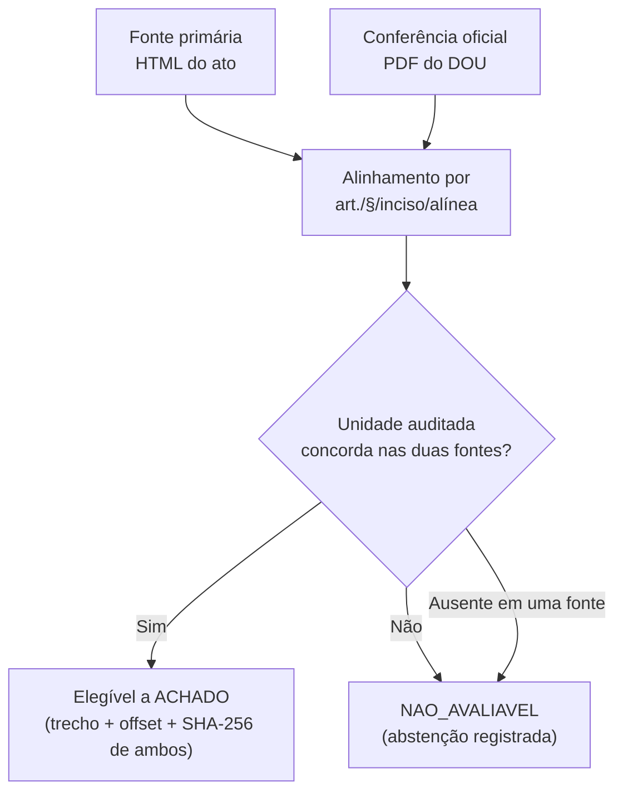

# Dupla Fonte Concordante

!!! info "Estágio neste repositório"
    Especificação. Resume a [ADR-002](decisoes/adr-002-dupla-fonte-concordante.md); o detector em `parser/` ainda não foi implementado.

Regras sensíveis à tipografia (`R3@1.0` e `R5@1.0`) só podem emitir `ACHADO` quando a mesma ocorrência aparece **nas duas fontes**: o HTML primário e o PDF oficial do Diário Oficial da União (DOU).

!!! abstract "Por que duas fontes?"
    Um desvio de pontuação ou de ordinal pode vir da conversão do portal ou da quebra de linha do PDF, e não da técnica legislativa do ato. Exigir concordância remove esse falso positivo; divergência vira `NAO_AVALIAVEL`.

## Fluxo de decisão

## Regras de decisão

| Situação | Estado resultante |
| --- | --- |
| Ocorrência presente e idêntica em HTML e PDF | Segue para o checker; pode virar `ACHADO` |
| Divergência tipográfica relevante na unidade auditada | `NAO_AVALIAVEL` |
| Unidade ausente em uma das fontes | `NAO_AVALIAVEL` |
| Regra não sensível à tipografia (ex.: `R1`, `R2`) | Dupla fonte não é exigida para `ACHADO` |

!!! warning "Trade-off assumido"
    A precisão aumenta e a cobertura automática cai nos atos cujo PDF tem desalinhamento estrutural. Por isso o protocolo experimental reporta **cobertura** junto com **precisão** e **risco seletivo**.

## Rastreabilidade

- Os hashes SHA-256 de HTML e PDF ficam em `data/manifesto.csv` por `ato_id`.
- A suíte planejada incluirá casos sintéticos de divergência para verificar a transição obrigatória a `NAO_AVALIAVEL`.

## Próximas leituras

- [ADR-002 — Dupla fonte concordante](decisoes/adr-002-dupla-fonte-concordante.md)
- [Pipeline e quarentena do LLM](index.md)
