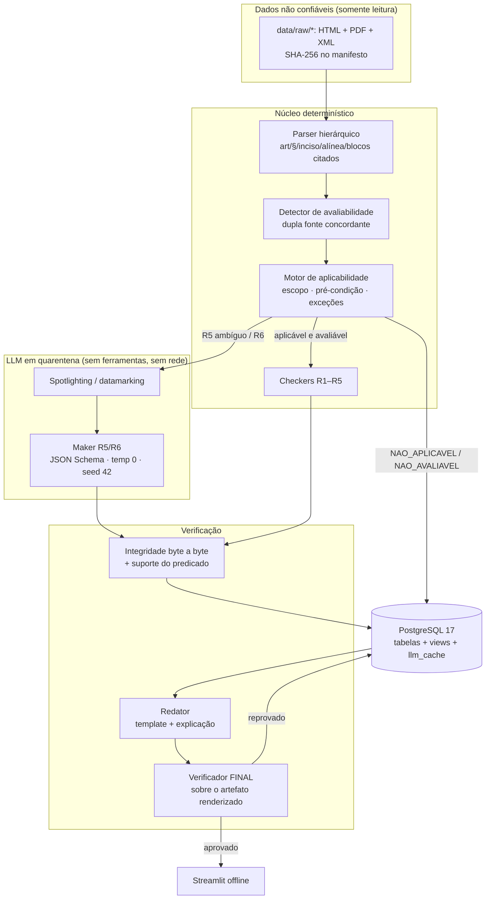

# Visão Geral da Arquitetura

> **Estágio:** Arquitetura alvo. Os diretórios de implementação (`domain/`, `parser/`, `rules/`, `retrieval/`, `llm/`, `pipeline/`, `verify/`, `eval/`, `sql/`, `app/`) existem como **stubs vazios**; a lógica será implementada nos próximos marcos.

O **Auditor 12.002** adota uma arquitetura enxuta centrada em **banco único (PostgreSQL 17)**, separação estrita entre **núcleo determinístico** e **LLM em quarentena**, verificação matemática pós-geração e operação **100% offline** após o download único dos pesos do modelo local.

## Topologia e Fluxo de Processamento

## Módulos Planejados no Repositório

| Módulo | Papel na Arquitetura |
| --- | --- |
| `domain/` | Contratos de dados e invariantes em Pydantic v2 (sem I/O). |
| `parser/` | Segmentação hierárquica (artigo, §, inciso, alínea, blocos citados) e detector de dupla fonte (HTML + PDF). |
| `rules/` | Motor de aplicabilidade (`NAO_APLICAVEL`) e checkers determinísticos `R1`–`R5`. |
| `retrieval/` | Indexação e busca lexical exata com `bm25s` (variante Lucene, `k1=1.2, b=0.75`). |
| `llm/` | Cliente Ollama estruturado (`qwen3:8b`, JSON Schema, `temp=0`, `seed=42`) e isolamento por *spotlighting/datamarking*. |
| `pipeline/` | CLI `typer`, ledger idempotente `llm_cache` e execução comparativa das condições `D/A/B/C`. |
| `verify/` | Verificadores de integridade byte a byte, suporte do predicado, métricas SQL e verificador FINAL sobre o artefato renderizado. |
| `eval/` | Cálculo de κ de Cohen, gerador de 120 mutações sintéticas, IC de Wilson (95%), *bootstrap* agrupado por ato e McNemar. |
| `sql/` | Schema relacional no PostgreSQL 17 e views analíticas de fechamento matemático. |
| `app/` | Dashboard analítico interativo em Streamlit offline (`http://localhost:8501`). |

## Quatro Defesas Estruturais

1. **Motor de aplicabilidade antes da detecção:** impede que exceções legais ou pré-condições ausentes caiam em checkers ou no LLM, separando `NAO_APLICAVEL` e `NAO_AVALIAVEL` antes da análise substantiva (ver [ADR-001](decisoes/adr-001-maquina-estados-e-abstencao.md)).
2. **Dupla fonte concordante:** regras sensíveis a tipografia e aspas só emitem `ACHADO` quando a evidência coincide simultaneamente na fonte primária (HTML) e na conferência oficial (PDF do DOU) (ver [ADR-002](decisoes/adr-002-dupla-fonte-concordante.md)).
3. **LLM em quarentena contra *prompt injection*:** textos legislativos contêm linguagem imperativa (`"deverá"`, `"fica vedado"`) que não pode ser sanitizada sem destruir o objeto da auditoria. Por isso, o texto entra marcado via *spotlighting/datamarking* em um modelo sem ferramentas e em rede Docker `internal: true` (ver [Threat Model](../seguranca/threat-model.md)).
4. **Determinismo e auditoria matemática:** chamadas ao LLM passam pelo ledger idempotente `llm_cache` no PostgreSQL 17; todo número exibido em relatórios é recomputado por views SQL e validado após a renderização final pelo `Verificador FINAL` (ver [ADR-003](decisoes/adr-003-banco-unico-postgres-e-ollama-offline.md)).

## Próximas leituras

- [Contratos e Banco Único (Especificação)](contratos-e-dados.md)
- [Índice de Decisões Arquiteturais (ADRs)](decisoes/index.md)
