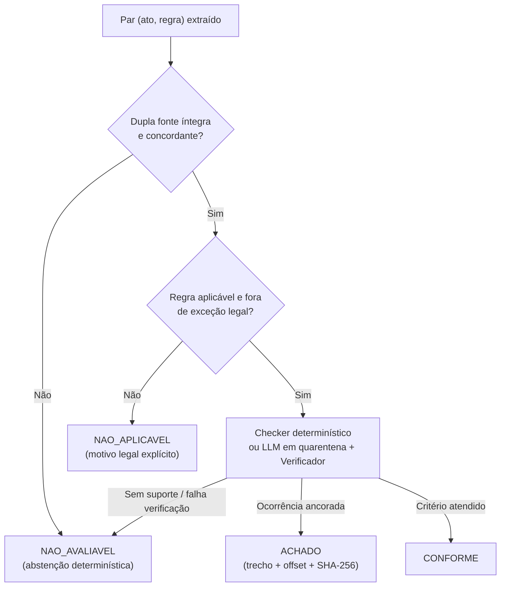

# Domínio e Semântica de Decisão

> **Estágio:** Especificação de domínio consolidada a partir do `README.md`. Os checkers e o motor de aplicabilidade em `rules/` aguardam implementação.

O **Auditor 12.002** é um assistente auditável de revisão de técnica legislativa aplicado a atos normativos federais publicados após **1º de junho de 2024** (art. 78 do **Decreto nº 12.002, de 22 de abril de 2024**) no âmbito da administração pública federal direta, autárquica e fundacional (art. 2º).

## O que o sistema faz e o que não faz

| Dimensão | Escopo definido |
| --- | --- |
| **Objeto de análise** | Atos normativos federais já publicados (proxy público oficial em HTML, PDF do DOU e XML quando disponível). |
| **Regras avaliadas** | 6 regras objetivas versionadas (`R1@1.0` a `R6@1.0`) derivadas do Decreto nº 12.002/2024. |
| **Saída produzida** | Classificação explícita `(ato, regra)` em 4 estados, com trecho literal ancorado por offset e hash quando `ACHADO`, ou motivo estruturado quando `NAO_APLICAVEL` / `NAO_AVALIAVEL`. |
| **Fora de escopo (Art. 76)** | Juízo de legalidade, validade ou constitucionalidade; avaliação de mérito político; garantia de "conformidade total"; revisão de minutas internas em tramitação. |

## Máquina de Estados `(ato, regra)`

Antes de acionar qualquer checker de conteúdo ou o modelo local em quarentena, o sistema separa **avaliabilidade** (qualidade e concordância da extração) e **aplicabilidade** (escopo e exceções legais explícitas):

### Semântica detalhada dos estados

!!! conforme "CONFORME"
    Emitido quando a regra é aplicável ao ato, a evidência necessária foi extraída sem divergência e os requisitos estruturais da regra foram atendidos.

!!! achado "ACHADO"
    Emitido apenas quando há ocorrência verificada de técnica legislativa com **âncora literal verificada byte a byte** (trecho, offset e hash no documento). Em regras sensíveis a tipografia e aspas (`R3`, `R5`), exige concordância simultânea entre HTML primário e PDF oficial do DOU.

!!! nao-aplicavel "NAO_APLICAVEL"
    Emitido pelo motor de aplicabilidade antes da detecção quando a pré-condição da regra não ocorre (ex.: ato que não altera outro ato em `R5`) ou quando incide exceção normativa expressa (ex.: decreto de promulgação de ato internacional em `R4`; ato exclusivamente alterador/revogador em `R6`).

!!! nao-avaliavel "NAO_AVALIAVEL"
    Abstenção obrigatória. Ocorre em falha de extração, divergência tipográfica entre HTML e PDF, falha de JSON Schema no LLM ou reprovação no verificador de integridade/predicado/final. Nenhum caminho de erro produz `CONFORME` ou `ACHADO` silenciosamente.

## Próximas leituras

- [Catálogo das 6 Regras (`R1@1.0` a `R6@1.0`)](regras-r1-r6.md)
- [Fronteira Jurídica (Art. 76 e Art. 70, III)](fronteira-art76.md)
