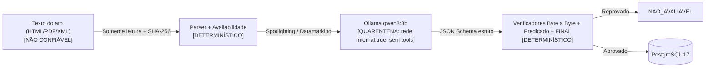

# Threat Model — Segurança e Isolamento do Pipeline

> **Estágio:** Modelo de ameaças inicial documentado com base na arquitetura do `README.md`. A suíte automatizada de segurança (`tests/security`, 12 cenários de *prompt injection* indireto) será implementada junto aos módulos `llm/` e `verify/`.

## 1. Ativos Protegidos e Fronteiras de Confiança

1. **Integridade do corpus e do gabarito:** `data/raw/*`, `data/manifesto.csv`, `data/MANIFEST.sha256` e `data/gold/gold-v1.csv`.
2. **Confiabilidade do veredito `(ato, regra)`:** prevenção contra alucinação de citações, falsos `ACHADO` ou emissão indevida de `CONFORME` em presença de ataque.
3. **Ambiente local e isolamento de rede:** garantia de que dados de entrada não provoquem chamadas de rede externas nem execução de ações arbitrárias.
4. **Conformidade com a fronteira jurídica (Art. 76):** garantia de que saídas não violem restrições redacionais mesmo sob injeção textual.

## 2. Matriz de Ameaças e Controles

| ID | Ameaça | Superfície | Controle arquitetural especificado | Estado |
| --- | --- | --- | --- | --- |
| `TM-01` | ***Prompt injection* indireto** em texto normativo ou mutação adversária | Entrada enviada ao LLM em `R5`/`R6` | Preservação da linguagem imperativa legítima com **spotlighting/datamarking**, separando dados de instruções de sistema | Planejado (`llm/`) |
| `TM-02` | **Agência excessiva / execução de ações ou exfiltração** via LLM | Serviço Ollama (`qwen3:8b`) | Modelo **sem ferramentas** (*zero tools*) em container na rede Docker `internal: true` (sem acesso à internet) | Planejado (`docker-compose.yml`) |
| `TM-03` | **Alucinação de trecho ou offset** para justificar `ACHADO` | Saída estruturada do Maker `R5`/`R6` | **Verificador de integridade byte a byte** + suporte do predicado; qualquer citação inexistente rebaixa para `NAO_AVALIAVEL` | Planejado (`verify/`) |
| `TM-04` | **Divergência entre fonte HTML e PDF oficial** | Extração de `R3`/`R5` | **Dupla fonte concordante**: divergência força abstenção `NAO_AVALIAVEL` | Planejado (`parser/`) |
| `TM-05` | **Manipulação pós-hoc de métricas ou números exibidos** | Relatórios e UI Streamlit | Recomputação exclusiva via **views SQL no PostgreSQL 17** e validação pós-renderização no `Verificador FINAL` | Planejado (`sql/`, `verify/`) |
| `TM-06` | **Adulteração do corpus ou gabarito após congelamento** | `data/raw/`, `manifesto.csv`, `gold-v1.csv` | Validação criptográfica `MANIFEST.sha256` (`verify/`) e guarda automática em PR no CI (`.github/workflows/ci.yml` + `scripts.check_governance`) | **Guarda de PR ativo no CI**; `verify.manifest` planejado (`verify/`) |
| `TM-07` | **Scripts, segredos ou Actions não confiáveis no repo/docs** | Portal MkDocs e esteira GitHub Actions | Plugin `privacy`, hook `docs_hooks/check_site.py`, *pinning* por SHA completo, `gitleaks` via `pre-commit` e CodeQL padrão | **Ativo no CI e no build de docs** |

## 3. Bateria Planejada de Testes de Segurança (`tests/security`)

O `README.md` prevê o comando `make test-sec` executando uma bateria de **12 ataques de *prompt injection* indireto** para validar que instruções embutidas em trechos simulados de atos (como tentativas de forçar `CONFORME`, suprimir `ACHADO` ou alterar o formato JSON) não contornam o JSON Schema, os marcadores de *datamarking* nem os verificadores pós-geração.
